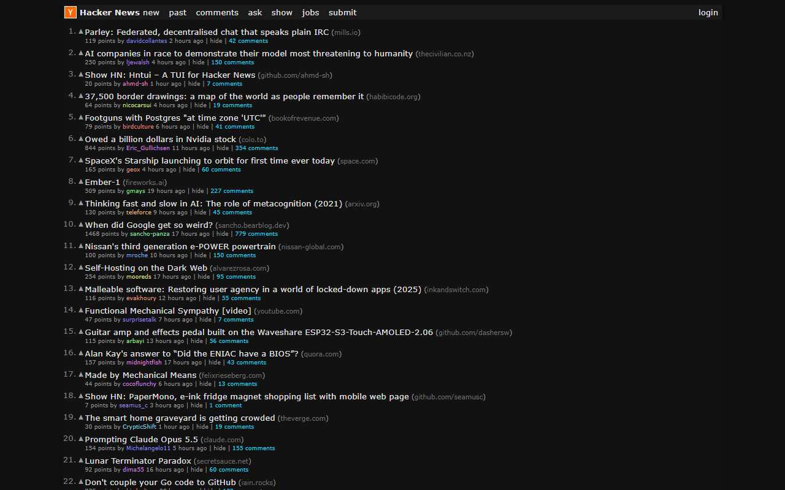

# Hacker News Modern UI Extension

A browser extension that gives Hacker News a modern, clean and fast look: color themes, modern typography and
spacing, readable comment threads and keyboard navigation. Works in Chrome (and other Chromium browsers) and Firefox.



## Features

- **Themes.** Dark (default), Light, Nord, Dracula, Gruvbox and Solarized Light, plus **System** (light or dark,
  following your OS) and **Original** (leave Hacker News untouched). Every theme meets WCAG AA contrast for text.
- **Modern layout** (on by default, can be turned off): system fonts, roomier spacing, a centered page, colored
  comment thread lines, an **OP** badge on the story author's comments and a bigger collapse button.
- **Density and text size:** comfortable or compact spacing, text at 90 / 100 / 110 / 125%.
- **Keyboard shortcuts** (can be turned off):

  | Key         | Action                                         |
  | ----------- | ---------------------------------------------- |
  | `j` / `k`   | Select the next / previous story or comment    |
  | `o`/`Enter` | Open the story, or collapse/expand the comment |
  | `c`         | Open the story's comments                      |
  | `Shift`     | With `o` or `c`: open in a new tab             |
  | `Esc`       | Clear the selection                            |

- Downvoted comments keep Hacker News' fading, on every theme.
- No flash of the original orange page: the last used settings are applied before the page renders.
- Settings live in `sync` storage and follow you across browsers. Change them from the toolbar popup or the
  options page; open tabs update instantly.
- Translated into 55 locales.

## Development

Requires [bun](https://bun.sh/).

```bash
bun install
bun run dev            # Chrome with hot reload (bun run dev:firefox for Firefox)
bun run build          # .output/chrome-mv3 (bun run build:firefox for Firefox)
bun run zip:all        # store packages for both browsers
```

To try a build, load `.output/chrome-mv3` as an unpacked extension from `chrome://extensions` (developer mode), or
`.output/firefox-mv2/manifest.json` from `about:debugging` in Firefox.

### Checks

```bash
bun run compile        # typecheck
bun run test           # unit tests: theme contrast, selections, preferences, layout CSS
bun run test:e2e       # builds, then runs the extension in Chromium against tests/e2e/fixtures
bun run format         # Prettier
```

The end-to-end tests use Playwright's Chromium; set `CHROME_PATH` to use another Chromium build.

### Project layout

- `entrypoints/content.ts`: the content script (runs at `document_start`).
- `entrypoints/popup`, `entrypoints/options`: the settings UI (Solid.js).
- `utils/theme.ts`: palettes and theme CSS. `utils/layout.ts`: modern layout CSS.
- `utils/storage.ts`: `sync:theme` and `sync:preferences`.
- `locales/`: translations via `@wxt-dev/i18n`. Every locale ships every string.
- `selectors.md`: notes on Hacker News' markup.

## Screenshots

The Chrome Web Store images live in `screenshots/` (1280x800 each). Regenerate them with
`bun run screenshots`; see `screenshots/README.md` for what each one shows.

## License

[MIT](LICENSE)
